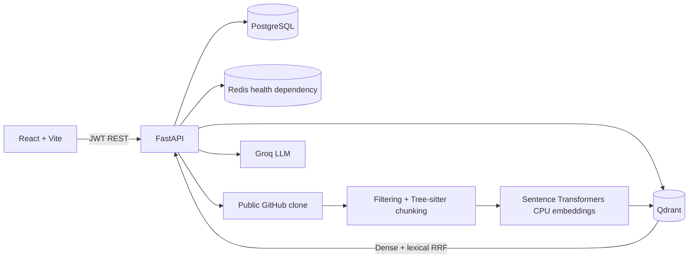

# Architecture

## Request boundaries

- JWT identifies the account; repository and conversation queries include the authenticated owner ID.
- Repository URLs must be HTTPS URLs on `github.com` with exactly owner/repository path segments.
- Clone content is treated as data. No build scripts or code are executed.
- Source chunks are stored with repository, owner, commit, branch, path, language, symbol, line, hash, and embedding model metadata.
- Qdrant is the source of retrieval content; PostgreSQL owns accounts, repository lifecycle, conversations, and generated documents.

## Retrieval

Queries receive normalized BGE-small embeddings. Dense Qdrant results and repository-scoped lexical matches are ranked separately and combined with Reciprocal Rank Fusion. Retrieved chunks are passed to Groq with instructions to cite `[S#]` references; the API returns corresponding file paths and source line ranges for clickable navigation.

## Indexing lifecycle

Repository creation persists a queued PostgreSQL record, then schedules an in-process background task. The task shallow-clones the requested branch into an isolated temporary directory, excludes binary/oversized/sensitive/known-generated files, chunks supported source languages, embeds in batches, upserts Qdrant points, records commit metadata, and removes the temporary checkout. A failed run marks the repository failed with a non-sensitive summary.
